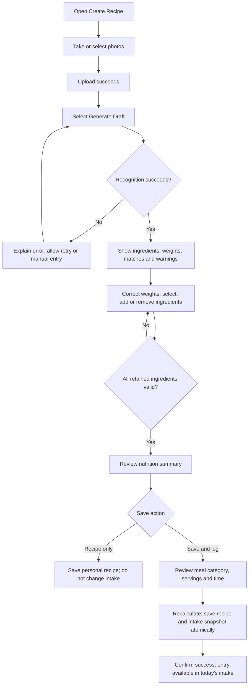

# FitnessProject Product Requirements Document

[简体中文](PRD_AI食物识别与饮食入账_v0.1.md) | **English**

## AI Food Recognition and Confirmed Intake Logging

| Document information | Details |
| --- | --- |
| Product | FitnessProject · Fitness & Nutrition Diary, a WeChat Mini Program |
| Author | Wenkai Zhan / Gordonzhan |
| Version | v0.1 · Product requirements baseline |
| Date | 2026-11-10 |
| Document type | Feature PRD based on the current implementation, including proposed improvements |
| Scope | Creating a recipe: from uploading food photos to confirming a food intake entry |
| Product stage | Local validation; the latest agent version is awaiting cloud deployment |

> Status convention: **Current** describes implemented behavior; **Proposed** describes future requirements. User hypotheses, research plans, and measurement proposals remain to be validated.

## 1. Background and Problem

Logging a meal typically involves finding ingredients, entering weights, calculating nutrition, and adding the result to the day's food intake. These steps can be burdensome for users with limited ingredient knowledge, no precise weighing equipment, or little time to record meals.

Photos provide clues about visible ingredients, but cannot reliably establish weights, hidden oils, seasonings, or the actual cooking process. Logging model outputs directly would carry recognition and estimation errors into subsequent nutrition analysis.

This feature aims to reduce manual entry while retaining user review: generate a recognition draft, match reference ingredients, adjust weights, and let the user decide whether to log the meal.

### 1.1 User Hypotheses

The initial audience is everyday fitness users who want to manage food intake and are willing to review ingredients and portions. Initial scenarios cover recognizable home-cooked meals, fitness meals, and simple meals eaten out.

The following hypotheses require interviews and usability testing:

- Users find individual ingredient searches and weight entry time-consuming.
- Users prefer editing a draft to starting with an empty form.
- Users understand that photo-based weights are estimates and will correct obvious errors.
- Ingredient selection and serving terminology are understandable without adding excessive effort.

Research status: formal user interviews and baseline product usage measurement have not yet been conducted.

### 1.2 Representative Task

A user wants to record chicken with rice. They take or select a photo and generate a draft. They reduce an overestimated chicken weight, select a reference entry for an ambiguous ingredient, confirm that they ate half the recipe, choose lunch and a consumption time, then save and log the meal for today.

Scenario type: a design hypothesis to be validated through user research.

## 2. Goals and Scope

### 2.1 Goals

1. Produce an editable ingredient draft from photos, reducing the effort of starting from a blank form.
2. Distinguish model estimates, reference-catalog data, and information requiring user confirmation.
3. Apply consistent nutrition calculations in preview and persistence, without treating model nutrition estimates as final records.
4. Separate saving a recipe from recording actual consumption, preventing unintended or duplicate intake entries.

### 2.2 Scope

| Included | Outside this feature's scope |
| --- | --- |
| Photo uploads and ingredient/weight drafts | Precisely measuring weights or hidden oils from photos |
| Reference-ingredient matching, manual selection, and weight corrections | Universal coverage of brands, restaurant recipes, and mixed dishes |
| Editable recipe-name and preparation suggestions | Establishing the actual cooking method from a photo |
| Nutrition preview, Save Recipe Only, and Save and Log Intake | Logging without explicit confirmation |
| Today's meal category, serving multiplier, and consumption time | Selecting historical dates on this page |
| Upload, recognition, and submission error handling | Implementing connectivity between the cloud service and local agent |

Workout planning, fitness conversations, and RAG are outside this PRD's detailed scope.

## 3. Core Flow

**Upload photos → identify ingredients and estimate portions → review and correct → confirm reference-ingredient matches → review recalculated nutrition → choose how to save.**

The system performs an initial reference-catalog match before returning the draft. Users then resolve ambiguity, omissions, and errors. Matching, corrections, and recalculation can repeat as needed.

## 4. Page and Information Structure

Reuse the existing Create Recipe page so recognition results and final editing remain in one place.

| Area | Information and actions | Status |
| --- | --- | --- |
| Photos | Camera, album, upload progress, errors, and removal | Current |
| AI recognition | Generate Draft / Recognizing / Recognize Again; first-three-images notice | Current |
| Recipe details | Editable name and preparation steps; label model-generated suggestions | Current |
| Ingredients | Reference name, recognized name, weight range, confidence, candidates, weight, add/remove | Current |
| Intake details | Breakfast / lunch / dinner / snack, serving multiplier, and time | Current |
| Nutrition summary | Protein, carbohydrate, fat, and calories update with edits | Current |
| Bottom actions | Save Recipe Only; Save and Log Intake | Current |
| Completeness and portion guidance | Separate matched-ingredient subtotal, full recipe, and actual intake | Proposed |

## 5. Functional Requirements

### FR-01 Upload and Recognition Entry

**User story:** I want to take or select photos, see which uploads succeeded, and then decide whether to run recognition.

Current rules:

- A recipe supports up to nine photos; recognition submits only the first three. Recognition does not run without an uploaded image.
- The page requests compressed images and reports results per upload. Successful uploads remain available if others fail.
- Mutually exclusive actions, including uploading, recognition, and submission, block repeated triggers.
- The product recognition endpoint verifies that images belong to the current user; arbitrary external image URLs are not accepted through this flow.

Proposed: reconcile the upload limit of 20 MB per image with the agent's default recognition limit of 10 MB. Check or compress images before recognition and provide an actionable message. Clearly show which images will be analyzed so users do not assume all nine are included.

### FR-02 Generate an Editable Draft

**User story:** I want the system to suggest ingredients and weights while letting me decide what to accept.

Current rules:

- Recognition starts only after Generate Draft is selected. Uploading does not save a recipe or log intake.
- Results include recognized ingredient names, estimated grams, weight ranges, model confidence, match status, and warnings.
- A separate text-generation step suggests a recipe name and preparation steps. It fills only empty fields and preserves user-entered content.
- Failure to generate text suggestions does not invalidate successful ingredient recognition; manual editing remains available.
- Generating a draft does not create a saved recipe or intake entry. The system may collect unmatched ingredient observations to improve the catalog.

Confidence is an uncalibrated model signal, not a measured recognition accuracy. Proposed: explain its meaning briefly and evaluate whether a review-needed label is more useful than emphasizing a percentage alone.

### FR-03 Ingredient Matching and Corrections

**User story:** I want to understand which reference ingredient a recognition item represents, including raw/cooked differences and generic estimates.

| Match condition | Current behavior | User action |
| --- | --- | --- |
| Unique reference name or alias | Automatically associate the specific reference ingredient | Review, retain, or replace |
| Fuzzy match or multiple possibilities | Leave unselected; show up to three candidates | Choose a candidate or search the catalog |
| Only a generic estimate is available | Label Generic Estimate; do not adopt automatically | Explicitly select to accept |
| No candidate | Preserve recognition information and request a reference ingredient | Search manually, remove, or replace |

Current rules: users can edit grams, add omitted ingredients, and remove incorrect items. The saved record retains the reference ingredient and recognized name, distinguishing automatic matches, user selections, and manual entry. Users cannot add public catalog entries directly through this flow.

Proposed: prompt users to review cooking oils, seasonings, and mixed dishes. Reminders must not insert weights without supporting information.

### FR-04 Nutrition Recalculation and Portion Definitions

**User story:** I want weight edits to update nutrition immediately and to distinguish the full recipe from what I actually ate.

Calculation rules:

- Ingredient nutrition = reference nutrition per 100 g × confirmed weight in grams ÷ 100.
- Full-recipe nutrition = sum of all retained ingredient calculations.
- Logged nutrition = server-recalculated full-recipe nutrition × serving multiplier.
- Client calculations support immediate preview. Java recalculates from reference ingredients before saving and overrides client-submitted nutrition.
- Current recipe calculations round each ingredient's nutrition to one decimal place before summing. Intake snapshots round scaled values to two decimal places. Displayed units and precision must remain understandable.

**One serving means the entire set of ingredient quantities entered in the current recipe.** It is not a system-inferred standard meal. If the recipe describes a dish for two and the user eats half, select 0.5 servings. Do not both halve ingredient weights and apply a half-serving multiplier.

Current usability gap: unmatched ingredients are excluded from the displayed total. Saving is blocked, but the total can still appear complete. Proposed: label it as a matched-ingredient subtotal, list unresolved items, and preview actual intake after applying the selected multiplier.

Calculation example, using illustrative rather than actual ingredient data: a 600 kcal recipe logs 300 kcal at 0.5 servings or 1,200 kcal at two servings.

### FR-05 Two Save Actions

| Action | Current result | Information to confirm |
| --- | --- | --- |
| Save Recipe Only | Save a personal recipe without changing today's intake | Ingredients, weights, and recipe details |
| Save and Log Intake | Save the recipe and create today's intake nutrition snapshot | Recipe details, meal category, servings, and consumption time |

Current rules:

- Today is based on the device's local date. This page has no historical-date selector.
- Meal categories are breakfast, lunch, dinner, and snack. A time-based default can be changed.
- The UI offers 0.5, 1, 1.5, and 2 servings, defaulting to 1. The backend accepts 0.25–10; the UI does not expose that entire range.
- Consumption time defaults to the current local time and can be adjusted.
- At least one valid ingredient is required. Unmatched, disabled, or invalid ingredients cannot support a valid save.
- If the recipe name is empty, the frontend currently supplies a time-based name. The backend requires a nonempty name of up to 20 characters. Proposed: visibly show the final name to reduce implicit behavior.

Proposed: validate each incomplete ingredient row and invalid weight. The frontend currently filters out rows missing a name or weight; backend validation alone does not prevent users from assuming every displayed row was saved.

### FR-06 Submission, Feedback, and Retries

Current rules:

- Lock related actions during submission and show Saving or Logging.
- Save the recipe and create the intake snapshot within one transaction. Roll back on failure rather than leave a partially completed operation.
- After an uncertain result, same-page retries reuse the recipe business identifier and intake request identifier. A user-and-request uniqueness constraint prevents duplicate intake inserts.
- Show action-specific success feedback and return to the previous page.
- Preserve edits on failure and allow retry. A timeout does not prove that the server failed to save.
- Historical intake uses the nutrition snapshot at logging time; later recipe edits should not rewrite past intake.

Boundary: retry identifiers currently live in the page instance. Recovery across page exits, app restarts, and devices is not guaranteed. If users change servings, meal category, or ingredients after an uncertain result and reuse the identifier, the current mechanism does not guarantee that the changes will be treated as a new intake entry.

Proposed: distinguish retrying an original submission from creating a new record, retain a submission summary, and check the original result when uncertain. Validate retries across dates, after form edits, and after reopening the page.

## 6. Errors and Exit Behavior

| Situation | Current behavior or constraint | Required experience |
| --- | --- | --- |
| Cancel image selection | No recognition request | Keep the form; do not treat cancellation as an error |
| Some uploads fail | Preserve successful uploads and report failures | Allow failed images to be uploaded again |
| Agent disabled, offline, or timed out | Recognition fails | Explain the problem and preserve manual entry; user-facing copy needs improvement |
| No food recognized | Prompt for manual entry | Do not present an empty result as a complete recognition |
| Name or step generation fails | Ingredient draft remains usable | Allow manual entry without blocking review |
| Ingredient unmatched or disabled | Block invalid saves | Identify the affected item; allow replacement or removal |
| Recognize again | Successful results replace ingredients; entered name and steps remain | Confirm replacement before overwriting corrected ingredients and weights; proposed |
| Leave without saving | Draft primarily lives in page memory | Do not promise recovery; exit warnings or draft restoration require implementation |
| Submission result uncertain | Allow retry with the current request identifier | Do not assert that nothing was saved or encourage creating duplicate records |

Uploading already writes files to storage. An unsaved recipe does not mean no files exist. Cleanup for unreferenced images is implemented, but failures may leave objects behind; immediate removal of all images on exit is not guaranteed.

## 7. Data and Authorization

- The server derives the current user from authentication. Clients cannot specify another user when saving.
- Product recognition accepts ownership-validated images; Python also validates image fetching addresses and sizes.
- Models provide recognition and suggestions without direct write access to the business database.
- Java owns nutrition calculations, ingredient validation, resource ownership, and persistence.
- Proposed analytics events must exclude photo URLs, full prompts, raw model outputs, personal nutrition records, and credentials.
- Before public release, define image retention, deletion access, and privacy notices, including incidental people and surroundings in photos.

## 8. Priorities and Iteration

The following priorities are proposals, not a committed delivery schedule or completed release.

| Priority | Requirement | Value |
| --- | --- | --- |
| P0 · Before public trial | Align upload/recognition size limits and show analyzed images | Avoid unusable uploads and confusion about recognition scope |
| P0 · Before public trial | Validate incomplete rows and label partial nutrition totals | Avoid omitted ingredients and underestimated intake |
| P0 · Before public trial | Explain serving definitions and preview actual intake | Avoid scaling both weights and servings unintentionally |
| P0 · Before public trial | Clarify uncertain-result retries and validate recovery | Prevent missing, duplicate, or misunderstood records |
| P1 | Confirm replacement on re-recognition; warn before leaving unsaved edits | Protect user corrections |
| P1 | Improve errors, waiting states, and confidence explanations | Make slow or unavailable inference understandable |
| P2 | Reference-object weight assistance, brand labels, or barcode entry | Expand coverage when supported by user feedback |

The version prioritizes review, editing, and explicit confirmation over fully automatic logging.

## 9. Acceptance Criteria

The table describes expected behavior and implementation status. Current does not mean all release acceptance checks are complete. Proposed behavior requires implementation and acceptance testing.

| ID | Scenario | Expected result | Status |
| --- | --- | --- | --- |
| AC-01 | Generate without an uploaded image | Request an image; send no recognition request | Current |
| AC-02 | Recognize with more than three uploaded images | Analyze only the first three and make the scope clear | Basic notice current; selected-image display proposed |
| AC-03 | Unique reference name or alias match | Associate reference ingredient; use catalog nutrition | Current |
| AC-04 | Ambiguous match or generic estimate only | Require explicit selection before valid saving | Current |
| AC-05 | Edit grams or replace reference ingredient | Update preview; use server calculations on save | Current |
| AC-06 | Unmatched ingredients remain | Block saving and label the total incomplete | Save blocking current; subtotal copy proposed |
| AC-07 | Recognize again after entering name and steps | Preserve both fields | Current |
| AC-08 | Recognize again after correcting ingredients | Confirm replacement and allow cancellation | Proposed |
| AC-09 | Save Recipe Only | Recipe can be retrieved; today's intake does not increase | Current; manually recheck before demonstration |
| AC-10 | Log lunch at 0.5 servings with a selected time | Persist metadata and half of full-recipe nutrition | Current |
| AC-11 | Tamper with client nutrition | Override using server reference-ingredient calculations | Current |
| AC-12 | Transaction fails while logging | Roll back recipe and intake changes together | Current transaction mechanism; targeted verification required |
| AC-13 | Retry an unchanged submission after an uncertain same-page result | Do not create duplicate intake | Current, with test coverage |
| AC-14 | Edit servings, cross midnight, or reopen after an uncertain result | Distinguish original/new operations and explain the final record | Further design and validation required |
| AC-15 | Uploaded image exceeds the agent recognition limit | Explain before recognition; guide compression or replacement | Proposed |
| AC-16 | Disable the agent or simulate a timeout | Allow manual entry; do not log automatically | Current error path; copy improvements proposed |

## 10. Evaluation and Measurement Plan

### 10.1 Validate Understanding and Task Completion

Plan an initial formative usability study with 5–8 participants matching the user hypotheses. Use meals with known ingredients and weights, plus authorized images. Compare manual entry with recognition-assisted entry and alternate task order to reduce familiarity effects.

Observe whether participants can independently complete a record, understand the full-recipe/serving distinction, detect obvious recognition errors, recognize that generic estimates do not represent precise recipes, and continue after errors.

### 10.2 Proposed Metrics

| Metric | Definition | Interpretation |
| --- | --- | --- |
| Task completion rate | Participants correctly completing the task / participants attempting it | Analyze individual failures in the initial study; do not generalize population effects |
| Time per record | Time from entry to a correctly confirmed record | Compare medians and distributions for manual and assisted entry |
| Recognition request success rate | Requests returning valid drafts / valid recognition requests | Separate image, network, model, and schema failures; not ingredient accuracy |
| Ingredient mapping coverage | Recognition items with a valid reference match or candidate / all recognized items | Separate automatic matches, user selections, and generic estimates |
| User correction rate | Items with edited name, mapping, or weight / reviewed recognition items | Locate issues; correction alone does not indicate a poor experience |
| Intake completion rate | Successfully logged tasks / tasks intended to log intake | Exclude recipe-only tasks to preserve user intent |
| Duplicate records | Extra intake entries created by the same confirmation operation | Acceptance target: zero for same-page retry tests |
| Recalculation consistency | Cases matching reference-ingredient/weight calculations / tested cases | All deterministic cases should pass; this does not measure weight-estimation accuracy |

Targets: collect a baseline first, then define improvement thresholds appropriate to user tasks, hardware, and model capability.

### 10.3 Events and Performance Definitions

Proposed events: open recipe creation, finish upload, request recognition, recognition success/failure, select ingredient, edit weight, submit save, and save success/failure. Event collection and the product analytics dashboard remain to be built.

Measure upload, vision inference, text suggestions, Java matching, and final saving separately. Distinguish cold-start and warm inference. Report P50/P95 when enough samples exist; a single local demonstration does not establish cloud performance.

## 11. Release Dependencies and Gates

The latest agent features are currently validated locally and have not been deployed to Tencent Cloud. Before a public trial:

- Establish usable connectivity between the cloud business service and agent; verify timeouts, offline behavior, and errors.
- Prepare the schema and reference catalog required for ingredient candidates, confirmed intake, and nutrition snapshots.
- Complete this PRD's P0 requirements and end-to-end acceptance for recognition, corrections, saving, retrieval, and repeated submission.
- Review image retention and deletion policies, authorization, and privacy notices.

The backend operations documentation maintains specific deployment and database migration procedures.
