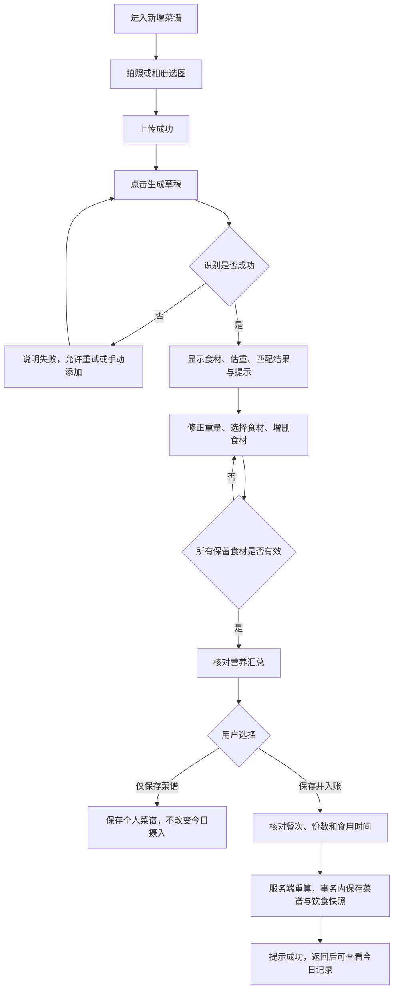

# FitnessProject 产品需求文档

**简体中文** | [English](PRD_AI_Food_Recognition_and_Intake.en.md)

## AI 食物识别与饮食确认入账

| 文档信息 | 内容 |
| --- | --- |
| 产品 | FitnessProject · 健身饮食日记微信小程序 |
| 作者 | 詹文楷 / Gordonzhan |
| 版本 | v0.1 · 产品需求基线 |
| 日期 | 2026-11-10 |
| 文档性质 | 基于已实现版本整理的功能 PRD，包含后续改进需求 |
| 适用范围 | 新增菜谱场景下，从上传食物照片到确认饮食入账 |
| 产品阶段 | 本地验证；最新 Agent 版本待云端部署 |

> 状态说明：“现有”为当前实现；“待改进”为后续需求。用户假设、研究计划和指标方案尚待验证。

## 1. 产品背景与问题

记录一顿饭通常需要查找食材、填写重量、计算营养，再将结果加入当天饮食。对缺少食材知识、没有精确称重条件或希望快速记录的用户，这些操作会增加记录负担。

照片可以提供可见食材的线索，但难以可靠判断重量、隐藏油脂、调味料和真实烹饪过程。直接把模型输出计入饮食，会把识别和估算误差带入后续营养分析。

本功能尝试缩短手动录入过程，同时保留用户核对与修正的机会：先给出识别草稿，再匹配标准食材、调整重量，最后由用户决定是否入账。

### 1.1 用户假设

优先服务需要管理日常饮食、愿意核对食材和份量的普通健身用户，先覆盖可辨认的家庭餐、健身餐和简单外食。

以下假设需要通过访谈和可用性测试验证：

- 用户认为逐项查食材和填写重量比较费时。
- 相比完全手动填写，用户更愿意修改已有草稿。
- 用户能够理解照片估重有误差，并愿意修正明显错误。
- 食材选择与份数表达足够清楚，不会增加新的理解负担。

研究状态：尚未开展正式用户访谈或收集产品使用基线。

### 1.2 典型任务

用户准备记录一份鸡肉配饭：拍照或从相册选图，生成识别草稿；发现鸡肉重量偏大后修改；为有歧义的食材选择标准条目；确认自己吃了半份，选择午餐与食用时间，再保存并计入今日饮食。

场景类型：设计假设，待用户研究验证。

## 2. 产品目标与范围

### 2.1 本版本目标

1. 让用户从照片得到可以修改的食材草稿，减少从空表单开始的输入。
2. 让用户知道哪些信息来自模型估算、哪些来自标准食材库、哪些需要自己确认。
3. 用一致的计算规则展示与保存营养，避免模型营养值直接成为正式记录。
4. 明确区分保存菜谱与记录实际食用，避免误入账和重复入账。

### 2.2 范围

| 本功能包含 | 本功能暂不包含 |
| --- | --- |
| 上传照片、生成食材与份量草稿 | 从照片准确测量食物重量或隐藏油脂 |
| 标准食材匹配、手动选择与重量修正 | 宣称适用于所有品牌、餐馆配方和混合菜 |
| 菜名与步骤的可编辑建议 | 证明图片中食物的真实做法 |
| 营养预览、仅保存菜谱、保存并入账 | 无需确认的自动入账 |
| 今日餐次、食用份数与时间确认 | 此页面的历史日期补录 |
| 上传、识别和提交失败处理 | 云端与本地 Agent 的通信方案实施 |

训练计划、健身问答和 RAG 不在本篇详细需求范围内。

## 3. 核心流程

用户理解的流程是：

**上传照片 → 识别食材和估算份量 → 核对并修正 → 确认标准食材匹配 → 查看重算营养 → 选择保存方式。**

系统在返回草稿前已做第一次标准食材匹配；用户核对时再处理歧义、遗漏与错误。匹配、修正和营养重算可以往返进行，不是只能执行一次的线性步骤。

## 4. 页面与信息结构

复用现有“新增菜谱”页面，避免识别结果和正式编辑分散在多个入口。

| 区域 | 主要信息与操作 | 状态 |
| --- | --- | --- |
| 图片 | 拍照、相册、上传进度、失败反馈、移除图片 | 现有 |
| AI 识别 | 生成草稿／识别中／重新识别；说明只读取前 3 张图 | 现有 |
| 菜谱信息 | 可编辑菜名与步骤；标注 AI 推测 | 现有 |
| 食材列表 | 标准名称、AI 原名、估重范围、置信度、候选、重量、增删操作 | 现有 |
| 入账信息 | 早餐／午餐／晚餐／加餐，食用份数和时间 | 现有 |
| 营养汇总 | 蛋白质、碳水、脂肪和热量随修改更新 | 现有 |
| 底部操作 | 仅保存菜谱、保存并入账 | 现有 |
| 完整性与份量说明 | 区分已匹配部分合计、整份菜谱和本次食用营养 | 待改进 |

## 5. 详细功能需求

### FR-01 上传与识别入口

**用户故事：** 我希望从相册或相机选图，知道哪些图片上传成功，再决定是否识别。

现有规则：

- 菜谱最多保留 9 张图片，识别只提交前 3 张；未上传图片时不执行识别。
- 页面优先选择压缩图片，逐张反馈上传结果；部分失败时保留成功图片。
- 上传、识别和提交等互斥操作期间阻止重复触发。
- 正式识别入口验证图片属于当前用户；客户端不能提交任意外部图片地址完成产品识别。

待改进：上传业务单图上限为 20 MB，Agent 默认单图上限为 10 MB。识别前应按配置检查或压缩图片，并给出可操作提示，避免用户上传成功后才得知无法识别。识别前还应清楚展示本次选中的图片；不能让用户误认为 9 张图片全部参与识别。

### FR-02 生成可编辑草稿

**用户故事：** 我希望系统先帮我填写可能的食材和重量，但由我决定是否采纳。

现有规则：

- 用户点击“生成草稿”才调用识别；上传图片本身不触发保存或入账。
- 返回食材原名、估算克数、估重范围、模型置信度、匹配状态及警告。
- 菜名和步骤由独立文本生成环节提供；只填充空字段，保留用户已填写的名称和做法。
- 文本建议失败不应使已成功的食材识别失效，用户仍可手动编辑。
- 生成草稿不会创建正式菜谱或饮食记录；系统可能统计未匹配食材，用于完善目录。

置信度是模型输出的参考信号，未经真实标注集校准，不能解释为“识别正确率”。待改进：使用简短说明解释其含义，并评估是否用“需核对”等提示替代单独突出百分比。

### FR-03 食材匹配与用户修正

**用户故事：** 我希望看懂识别项对应哪种食材，尤其能区分生熟、具体食材与通用估算。

| 匹配情形 | 现有处理 | 用户动作 |
| --- | --- | --- |
| 唯一标准名称或唯一别名命中 | 自动关联具体标准食材 | 核对后保留或更换 |
| 模糊匹配或多个可能结果 | 不自动选定，最多展示 3 个候选 | 选择候选，或搜索其他标准食材 |
| 仅有通用估算可用 | 标注“通用估算”，不自动采用 | 用户明确点击后才采用 |
| 无候选 | 保留原始识别信息，提示需选择基础食材 | 手动搜索、删除或替换 |

现有规则：支持调整克数、手动添加遗漏食材、移除误识别项；保存映射后的标准食材及 AI 原名，区分自动匹配、人工选择和手动录入。普通用户不能在此流程直接新增公共食材。

待改进：对烹调用油、调味料和混合菜提供核对提醒；这属于提醒用户补充信息，不能自动填入没有依据的重量。

### FR-04 营养重算与份量口径

**用户故事：** 我希望修改重量后立即看到营养变化，并能分清整份菜谱和自己实际吃下的份量。

计算规则：

- 单项营养 = 标准食材每 100 g 营养 × 用户确认克数 ÷ 100。
- 整份菜谱营养 = 所有保留食材的计算结果之和。
- 本次入账营养 = 服务端重算的整份菜谱营养 × 食用份数。
- 页面计算用于即时预览；保存前由 Java 根据标准食材重新计算，覆盖客户端营养值。
- 当前菜谱按单项营养保留一位小数后汇总，饮食快照缩放后保留两位小数；界面展示应明确单位并保持可解释性。

“1 份”在此流程中指当前菜谱填写的全部食材总量，不是系统推断的标准餐份。若填写的是两人份整盘菜，自己吃了一半，应选择 0.5 份；不能既把克数减半，又再选择半份。

**现有可用性缺口：** 未匹配食材不参与页面营养合计，虽然保存会被阻止，但合计仍可能看起来完整。待改进：标注“仅合计已匹配食材”，列出待处理项，并在入账确认区域展示本次份数对应的摄入预览。

示例（仅用于计算说明，不是真实食材营养数据）：整份菜谱为 600 kcal，用户选择 0.5 份，则入账 300 kcal；选择 2 份，则入账 1,200 kcal。

### FR-05 两种保存方式

| 操作 | 现有结果 | 确认内容 |
| --- | --- | --- |
| 仅保存菜谱 | 保存个人菜谱，不改变今日摄入 | 食材、重量、菜谱信息 |
| 保存并入账 | 保存菜谱，并生成今日饮食营养快照 | 上述内容，以及餐次、食用份数、食用时间 |

现有规则：

- 今日日期取设备本地日期；此页面没有历史日期选择器。
- 餐次提供早餐、午餐、晚餐、加餐，按时间默认选择，用户可以修改。
- 前端份数选项为 0.5、1、1.5、2，默认 1；后端允许范围为 0.25–10，不等于界面已支持全部范围。
- 食用时间默认当前本地时间，可由用户调整。
- 至少需要一项有效食材；未匹配、已停用或参数无效的食材不能作为有效保存依据。
- 菜谱名称留空时，当前前端会按时段生成名称；后端要求名称非空且不超过 20 字符。待改进：界面明确展示最终采用的名称，减少隐式填充。

待改进：当前前端会过滤名称或重量为空的食材行，不能只依赖服务端校验。应逐行提示不完整或非法重量，防止用户误以为所有显示项均已保存。

### FR-06 提交、结果反馈与重试

现有规则：

- 提交期间锁定相关操作，显示“保存中”或“入账中”。
- 保存菜谱与创建饮食快照处于同一事务；发生错误时回滚，避免只完成一部分。
- 页面在结果不明确后的重试中复用菜谱业务编号与入账请求编号；饮食记录依靠用户与请求编号唯一约束防止重复插入。
- 成功后提示“保存成功”或“已保存并记入今日饮食”，随后返回。
- 失败时保留编辑内容并允许重试，不将超时直接解释为服务端一定没有保存。
- 历史饮食采用当时的营养快照，后续修改菜谱不应回写过去的摄入。

边界：当前重试编号保存在页面实例中，不能宣称具备跨退出、重启或跨设备的完整幂等恢复。若结果未知后用户修改份数、餐次或食材，再沿用原编号提交，现有机制也不能保证修改被视为一笔新入账。

待改进：识别“重试原提交”和“发起新记录”，保留原提交摘要；结果未知时优先核实原结果。需要验证跨日重试、修改表单后重试及离开页面重进等场景。

## 6. 异常与退出体验

| 情况 | 当前行为或约束 | 产品处理要求 |
| --- | --- | --- |
| 用户取消选图 | 不产生识别请求 | 保留当前表单，不当作错误 |
| 部分图片上传失败 | 成功图片保留，有失败提示 | 允许补传失败图片 |
| Agent 未启用、离线或超时 | 识别请求失败 | 提供清楚原因，保留手动录入路径；面向用户文案待优化 |
| 未识别到食物 | 提示手动添加 | 不把空结果描述为完整有效的识别 |
| 菜名或步骤生成失败 | 食材草稿仍可使用 | 允许手动填写，不阻断核对 |
| 食材无匹配或已停用 | 阻止无效保存 | 定位待处理食材，允许更换或删除 |
| 重新识别 | 成功结果会替换食材列表，已填写菜名与步骤保留 | 增加覆盖确认，避免丢失已修正的食材与重量；待实现 |
| 离开未保存页面 | 当前草稿主要在页面内存中 | 不承诺自动恢复；增加未保存提醒或草稿恢复需单独实现 |
| 提交结果未知 | 提示可重试并复用当前请求编号 | 不提示“肯定未保存”，防止用户重复建立新记录 |

图片上传属于已经发生的存储操作，不能把“未保存菜谱”理解为“没有任何文件写入”。未引用图片清理已有处理，但清理失败可能留下对象；本功能不承诺离开页面后图片立即全部清除。

## 7. 数据与权限边界

- 当前用户身份来自服务端认证，客户端不能指定任意用户完成保存。
- 正式识别仅使用归属验证通过的图片；Python 的图片获取仍受地址与大小校验约束。
- 模型负责识别和建议，不具备直接写入业务数据库的权限。
- 营养计算、食材有效性校验、资源归属和持久化由 Java 执行。
- 拟议的产品分析事件不得记录照片地址、完整提示词、模型原文、个人营养记录或凭证。
- 公开发布前需明确图片保留期限、删除入口和隐私告知，覆盖照片中可能包含的人物及环境信息。

## 8. 优先级与迭代建议

以下为产品建议，不表示已经安排开发或完成上线。

| 优先级 | 内容 | 价值 |
| --- | --- | --- |
| P0 · 公开试用前 | 协调上传与识别大小限制，显示本次识别图片 | 避免已上传图片无法使用及识别范围误解 |
| P0 · 公开试用前 | 不完整食材逐行校验、营养合计完整性提示 | 避免漏项保存和摄入低估 |
| P0 · 公开试用前 | 份量口径说明与本次摄入预览 | 避免重量和份数双重缩放 |
| P0 · 公开试用前 | 结果未知后的重试语义与恢复验证 | 避免漏记、重复或错误理解修改结果 |
| P1 | 重新识别覆盖确认、未保存退出提醒 | 保护用户已完成的编辑 |
| P1 | 失败文案、等待体验、置信度说明 | 改善模型慢或不可用时的可理解性 |
| P2 | 参考物辅助估重、品牌标签或条码入口 | 在真实反馈支持后扩大场景 |

当前依然优先保证用户可核对、可修改、可明确确认，不将“一键全自动”作为本版本目标。

## 9. 验收标准

下表描述预期行为与实现状态；“现有”不等于已完成全部发布验收，待改进项需实现后验收。

| 编号 | 场景与操作 | 预期结果 | 状态 |
| --- | --- | --- | --- |
| AC-01 | 未上传图片，尝试生成草稿 | 提示先上传图片，无识别请求 | 现有 |
| AC-02 | 上传超过 3 张图片后识别 | 仅前 3 张参与，范围清楚 | 现有基础提示；选中范围展示待改进 |
| AC-03 | 名称或别名唯一命中标准食材 | 关联标准食材，营养取数据库值 | 现有 |
| AC-04 | 模糊匹配或只命中通用估算 | 不自动采用，选择后才参与有效保存 | 现有 |
| AC-05 | 修改食材克数或更换标准食材 | 营养随之变化，保存按服务端结果 | 现有 |
| AC-06 | 仍有未匹配食材 | 阻止保存，且合计明确为不完整 | 阻止保存现有；合计文案待改进 |
| AC-07 | 已填写菜名与步骤后重新识别 | 保留这两个字段 | 现有 |
| AC-08 | 已修正食材后重新识别 | 替换食材前确认，可取消 | 待实现 |
| AC-09 | 仅保存菜谱 | 可再次读取菜谱，今日饮食不增加 | 现有，演示前人工复验 |
| AC-10 | 选择午餐、0.5 份和时间后入账 | 保存对应元数据，摄入为整份营养的一半 | 现有 |
| AC-11 | 客户端篡改营养数值 | 服务端以标准食材计算覆盖 | 现有 |
| AC-12 | 入账事务中途失败 | 菜谱与饮食变更回滚，不留下半完成结果 | 现有事务机制，定向复验 |
| AC-13 | 同页原请求结果未知后原样重试 | 不重复增加饮食记录 | 现有，有测试覆盖 |
| AC-14 | 结果未知后修改份数、跨日或重开页面 | 区分原请求和新操作，能说明最终记录 | 待补充设计与验证 |
| AC-15 | 上传成功图片大于 Agent 识别上限 | 识别前说明并引导压缩或换图 | 待改进 |
| AC-16 | 关闭 Agent 或模拟超时 | 可继续手动录入，不自动入账 | 现有错误路径，用户文案待优化 |

## 10. 效果验证与指标方案

### 10.1 先验证任务能否理解和完成

计划邀请 5–8 名符合目标用户假设的参与者进行首轮形成性可用性测试。使用已知重量、已知食材的测试餐与取得授权的图片，分别完成手动录入和识别辅助录入；交替任务顺序，降低熟悉流程带来的影响。

观察：是否能独立完成记录、是否理解“整份”和“食用份数”、是否发现明显误识别、是否知道通用估算不等于精确配方，以及失败后如何继续操作。

### 10.2 建议指标

| 指标 | 定义 | 使用方式 |
| --- | --- | --- |
| 任务完成率 | 正确完成指定记录任务人数 / 尝试人数 | 首轮逐人分析失败原因，不外推总体效果 |
| 单次记录耗时 | 从进入录入到正确确认成功的时间 | 对比手动与识别辅助的中位数和分布 |
| 识别请求成功率 | 返回有效识别草稿的请求数 / 合法识别请求数 | 区分图片、网络、模型和结构校验失败；不等于食材准确率 |
| 食材映射覆盖率 | 能提供有效标准食材匹配或候选的识别项 / 全部识别项 | 区分自动匹配、人工选择和通用估算 |
| 用户修正率 | 被用户修改名称、映射或重量的识别项 / 已核对识别项 | 辅助定位问题；修正并不必然代表体验差 |
| 入账完成率 | 成功确认入账的任务 / 以入账为目标的任务 | 排除只想保存菜谱的用户，避免混淆意图 |
| 重复记录数 | 同一确认操作最终产生的额外饮食记录数 | 同页重试测试的验收目标为 0 |
| 营养重算一致性 | 保存结果符合标准食材与重量计算的用例 / 已测用例 | 确定性用例应全部通过，不代表估重准确 |

指标目标：先采集基线，再根据用户任务、设备和模型能力确定改进阈值。

### 10.3 事件建议与性能口径

拟议事件包括：进入新增、上传完成、请求识别、识别成功／失败、选择食材、修改重量、发起保存、保存成功／失败。事件采集与产品分析看板尚待建设。

延迟分别统计上传、视觉识别、文本建议、Java 匹配和最终保存；冷启动与热态推理分开。后续样本足够时再报告 P50/P95，不能用单次本地演示代表云端性能。

## 11. 发布依赖与验收门槛

最新 Agent 功能目前在本地验证，尚未部署到腾讯云。公开试用前需完成：

- 云端业务服务与 Agent 的可用通信，并验证超时、离线和错误反馈。
- 标准食材、确认入账及营养快照所需的数据结构与参考目录准备。
- 本文 P0 需求，以及识别、修正、保存、重新读取和重复提交的端到端验收。
- 图片保留与删除策略、权限和隐私告知核对。

具体部署操作与数据库迁移步骤由后端运行文档维护。
