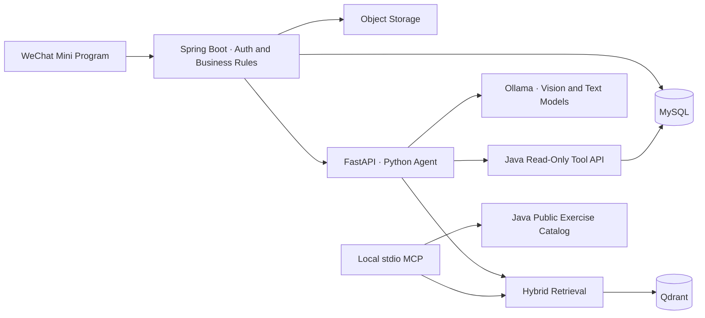

# FitnessProject · Fitness & Nutrition Diary

[简体中文](README.md) | **English**

A WeChat Mini Program for everyday workout and nutrition tracking, maintained by
[Gordonzhan](https://github.com/Gordonzhan). The project brings food logging, workout planning,
personal progress analysis, and a local model agent into one workflow: record activity,
get suggestions, edit a draft, confirm changes, and review the results.

The latest agent features have been validated locally and have not yet been deployed to Tencent Cloud.
Connectivity between the cloud service and the local agent is still pending.

## Features

- **Food logging:** recipes, photos, ingredient search, portion adjustments, and daily nutrition summaries.
- **Food recognition:** a local vision model identifies ingredients and produces an editable draft.
  After confirmation, the backend recalculates nutrition from the reference food catalog and logs the intake.
- **Workout management:** exercise catalog, equipment and training preferences, planned and completed workouts,
  exercise instructions, and calorie estimates.
- **Workout drafts:** generate a plan based on target muscle groups, available equipment, and personal constraints;
  replace or remove exercises and adjust sets before saving.
- **Fitness conversations:** answer questions using personal profiles, recent workouts, and nutrition records,
  with persistent conversation history.
- **Knowledge retrieval:** combine keyword and vector search with source citations.
  A local read-only MCP demo exposes knowledge search and the public exercise catalog.
- **Progress analysis:** weight, nutrition, and workout trends, plus step synchronization through WeChat's fitness API.

## Design Decisions

The project focuses on turning model suggestions into workflows that users can inspect and edit.

| Challenge | Approach |
| --- | --- |
| Models can misidentify ingredients, portions, or nutrition | Recognition produces an editable draft; Java recalculates final nutrition using reference ingredients |
| Generated exercises may not exist or may violate constraints | Generate only from filtered exercise candidates, with validation in both Python and Java |
| A conversation could accidentally trigger a save | The agent uses controlled read-only tools; food logging and workout saves require explicit user confirmation |
| Retried requests can create duplicate records | Protect confirmation flows with request identifiers, unique constraints, and transactions |
| General knowledge can be confused with personal records | Retrieve cited general knowledge through RAG and fetch current personal data through authorized Java tools |
| Large contexts slow local inference | Select tools by intent, limit conversation history and retrieved text, and record stage timings |

## Architecture



Java handles authentication, resource ownership, transactions, nutrition and calorie calculations,
and message persistence. Python handles model adapters, Pydantic validation, LangGraph workflows,
tool calls, and knowledge retrieval. It does not connect directly to the business database.

## Tech Stack

| Component | Technologies |
| --- | --- |
| Mini Program | Native JavaScript, WXML, WXSS, ECharts |
| Backend | Java 17, Spring Boot 3, MyBatis, Spring Data JPA, MySQL, Maven |
| Agent | Python 3.12–3.14, FastAPI, Pydantic, LangGraph, Ollama |
| Knowledge and tools | Qdrant, hybrid retrieval, MCP stdio |
| Validation | Node.js Test Runner, JUnit, H2, pytest, Ruff, Mypy, offline retrieval evaluation |

## Run Locally

Install WeChat DevTools, Node.js, Java 17, Maven, and MySQL.
Running the real agent also requires Python and Ollama; knowledge retrieval requires Qdrant.

```bash
git clone https://github.com/Gordonzhan/FitnessProject.git
cd FitnessProject
cp project.config.example.json project.config.json
cp backend/.env.example backend/.env
```

Set your Mini Program AppID in `project.config.json` and configure the database and object storage
in `backend/.env`. Prepare a separate development database following the
[backend guide (Chinese)](backend/README.md), then start the services:

```bash
npm run dev:prepare
cd backend
mvn spring-boot:run
```

Import the repository root into WeChat DevTools. The local `127.0.0.1` address works for the DevTools simulator;
a physical device needs a reachable backend address. The agent is disabled by default.
See the [agent guide (Chinese)](ai-agent/README.md) for setup and integration instructions.

## Checks and Tests

```bash
# Repository root: Mini Program logic tests
npm test

# Java: tests use H2 and mocks, without connecting to production databases
cd backend
mvn test

# Python: switch from backend to ai-agent and activate the virtual environment
cd ../ai-agent
source .venv/bin/activate
make check
make rag-eval
```

Offline retrieval evaluation uses fixed samples, fake embeddings, and an in-memory vector store for regression checks.
These results do not replace real-model evaluation or assessment on a larger dataset.

## Repository Layout

- `pages/`, `components/`, `utils/`: Mini Program pages, components, and API utilities.
- `backend/`: Java service, database schema, and incremental migrations.
- `ai-agent/`: Python agent, knowledge corpus, evaluation, and MCP demo.
- `tools/`: runtime configuration switching, frontend tests, and reference-data tools.
- Further documentation (Chinese): [database design](backend/database-design.md),
  [knowledge corpus](ai-agent/knowledge/README.md), and [security](SECURITY.md).

## Product Requirements

[AI Food Recognition and Confirmed Intake Logging — PRD](PRD_AI_Food_Recognition_and_Intake.en.md) · [简体中文](PRD_AI食物识别与饮食入账_v0.1.md)

User scenarios, interaction flows, business rules, acceptance criteria, and a measurement plan, with current behavior distinguished from proposed improvements.

## Deployment Status and Limitations

The existing Tencent Cloud service has not been updated to the latest agent version in this repository.
Cloud-to-local connectivity, the latest database migrations, and end-to-end cloud validation remain deployment prerequisites.

MCP is currently a local read-only demo. Model outputs and calorie estimates support everyday fitness tracking
and do not replace professional medical advice. Real credentials, personal data, logs, and local configuration
are excluded from version control.
