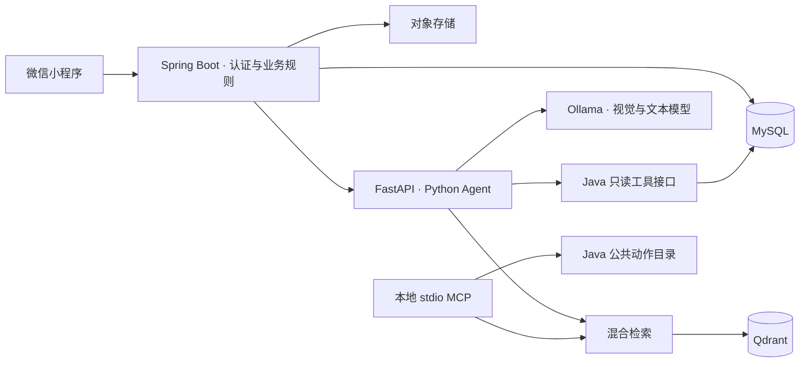

# FitnessProject · 健身饮食日记

**简体中文** | [English](README.en.md)

面向日常训练和饮食管理的微信小程序，由 [Gordonzhan](https://github.com/Gordonzhan) 维护。
项目把饮食记录、训练计划、个人阶段分析与本地模型 Agent 放在同一条使用流程中：
从记录数据、生成建议，到编辑草稿、确认保存，再回看实际执行结果。

最新 Agent 功能已在本地运行验证，尚未部署到腾讯云；云端与本地 Agent 的通信链路仍待接通。

## 功能

- **饮食记录**：菜谱、图片、食材检索、份量调整与每日营养汇总。
- **食物识别**：本地视觉模型识别食材，生成可编辑草稿；确认后按标准食材库重算营养并入账。
- **训练管理**：动作目录、器械与训练偏好、计划与完成状态、动作说明和热量估算。
- **训练草稿**：根据目标部位、可用器械和个人限制生成计划，支持替换、删除动作和调整组数。
- **健身对话**：结合个人档案、近期训练和营养记录回答问题，保存会话历史。
- **知识检索**：关键词与向量混合检索，展示知识来源；本地只读 MCP Demo 可复用知识与公共动作目录。
- **阶段分析**：体重、饮食和训练趋势，以及微信运动步数同步。

## 设计取舍

这个项目的重点是让模型建议落到可核对、可修改的业务流程里。

| 问题 | 实现方式 |
| --- | --- |
| 模型可能猜错食材、份量或营养 | 识别只生成草稿，用户可修改；最终营养由 Java 按标准食材重新计算 |
| 模型可能编造动作或忽略限制 | 只从经过偏好过滤的动作候选中生成，Python 和 Java 分层校验 |
| 对话建议可能误触发保存 | Agent 使用受控只读工具，饮食入账和训练保存由用户明确确认 |
| 重试可能造成重复记录 | 使用请求标识、唯一约束和事务保护确认流程 |
| 通用知识与个人数据容易混淆 | 通用知识走带来源的 RAG，实时个人数据通过 Java 授权工具读取 |
| 本地推理上下文过大会拖慢响应 | 按意图选择工具、限制历史窗口和检索正文，记录各阶段耗时 |

## 架构



Java 管理认证、资源归属、事务、营养与热量计算以及消息持久化。
Python 管理模型适配、Pydantic 数据校验、LangGraph 工作流、工具调用和知识检索，不直接连接业务数据库。

## 技术栈

| 模块 | 技术 |
| --- | --- |
| 小程序 | 原生 JavaScript、WXML、WXSS、ECharts |
| 后端 | Java 17、Spring Boot 3、MyBatis、Spring Data JPA、MySQL、Maven |
| Agent | Python 3.12–3.14、FastAPI、Pydantic、LangGraph、Ollama |
| 知识与工具 | Qdrant、混合检索、MCP stdio |
| 验证 | Node.js Test Runner、JUnit、H2、pytest、Ruff、Mypy、离线检索评测 |

## 本地运行

需要微信开发者工具、Node.js、Java 17、Maven 和 MySQL。
运行真实 Agent 还需要 Python 与 Ollama；启用知识检索时需要 Qdrant。

```bash
git clone https://github.com/Gordonzhan/FitnessProject.git
cd FitnessProject
cp project.config.example.json project.config.json
cp backend/.env.example backend/.env
```

在 `project.config.json` 中填写自己的小程序 AppID，在 `backend/.env` 中配置数据库和对象存储。
按[后端说明](backend/README.md)准备独立开发数据库，再启动：

```bash
npm run dev:prepare
cd backend
mvn spring-boot:run
```

用微信开发者工具导入仓库根目录。本地配置中的 `127.0.0.1` 适用于开发者工具模拟器；真机需要可访问的后端地址。
Agent 默认关闭，启用与联调方式见 [Agent 说明](ai-agent/README.md)。

## 检查与测试

```bash
# 仓库根目录：小程序逻辑测试
npm test

# Java：测试使用 H2 和 Mock，不连接生产数据库
cd backend
mvn test

# Python：从 backend 切换到 ai-agent，并激活虚拟环境
cd ../ai-agent
source .venv/bin/activate
make check
make rag-eval
```

离线检索评测采用固定样本、Fake Embedding 和内存向量库，用于回归检查；结果不能替代真实模型和更大样本的质量评估。

## 目录

- `pages/`、`components/`、`utils/`：小程序页面、组件与接口层。
- `backend/`：Java 服务、数据库结构和增量迁移。
- `ai-agent/`：Python Agent、知识语料、评测与 MCP Demo。
- `tools/`：运行环境切换、前端测试和参考数据工具。
- [数据库设计](backend/database-design.md)、[知识语料](ai-agent/knowledge/README.md)、[安全说明](SECURITY.md)。

## 部署状态与边界

腾讯云上的现有服务尚未更新到本仓库的最新 Agent 版本。本地 Agent 与云端的通信、最新数据库迁移和端到端云端验证仍是部署前提。
MCP 目前是本地只读演示。模型输出与热量估算用于日常健身参考，不能替代专业医疗建议。
真实凭证、个人数据、日志和本地配置不纳入版本控制。
